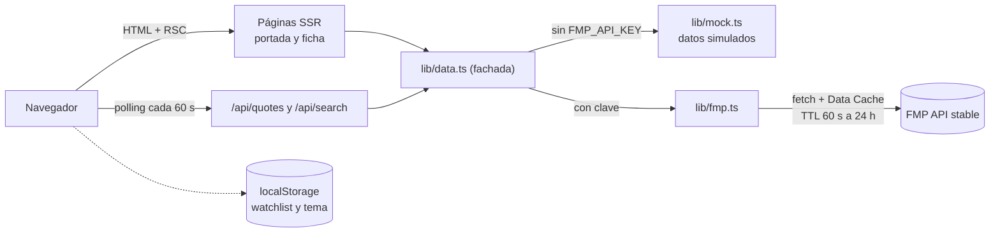
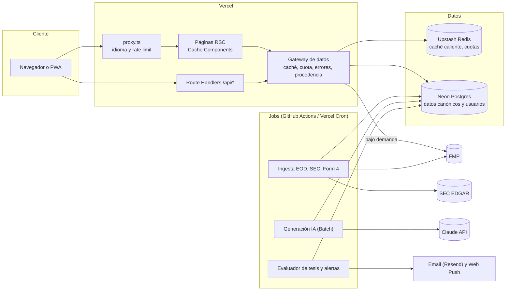

# IEP Analytics — Plan de producto (Fases 1–4)

> **Estado:** borrador para aprobación · **Fecha:** 2026-11-06 · **Alcance:** auditoría, benchmark, visión/roadmap y arquitectura. Este documento **no** cambia código.
>
> **Evidencia usada:** revisión completa del repositorio (`main` @ `f8100c2`, 2.549 líneas en `src/`), pruebas contra producción (https://iepanalytics.vercel.app), auditoría local con Playwright + axe-core 4.14 (WCAG 2.2 AA) y precios/licencias consultados el 2026-11-06 (fuentes al final).

---

## 0. Resumen ejecutivo

**Dónde estamos.** IEP Analytics funciona en producción con datos reales de FMP: buscador, ficha con gráfico e indicadores, fundamentales con semáforo, resumen en lenguaje simple y watchlist local, en ES/EN y en modo claro/oscuro. La base de código es limpia (4 dependencias, TypeScript estricto, lógica financiera con tests), pero **todavía no es un producto publicable ni escalable**.

**Tres bloqueantes antes de crecer:**

1. **Licencia de datos.** Según los términos de FMP, los planes estándar son de uso personal y no comercial; mostrar datos en un sitio público requiere un *Data Display and Licensing Agreement* aparte, aunque el acceso sea gratis. Hoy el sitio público muestra datos de FMP sin ese acuerdo (a confirmar con FMP; esto no es asesoría legal).
2. **Cuota y resiliencia.** Si la clave es del plan gratis (lo sugiere que las noticias y QQQ, DIA e IWM no respondan), su límite de 250 llamadas/día se agota con unas 20 visitas a la portada o 35 fichas nuevas, y los endpoints públicos permiten que cualquiera lo agote. Cuando FMP falla, la app no lo dice: muestra "acción no encontrada" o secciones vacías.
3. **Confianza en el análisis.** Los semáforos usan umbrales absolutos sin contexto sectorial ni histórico (ej.: ROE de AAPL 128 % marcado "Bien", inflado por recompras), los datos no muestran fuente ni hora, y si falta la clave se sirven precios simulados con nombres reales.

**Segmento a dominar:** inversionistas minoristas hispanohablantes que operan acciones de EE. UU. con una tesis y horizonte de 2 semanas a 6 meses (swing/position).

**Propuesta:** *el copiloto de tesis*. Una ficha que decide en 60 segundos (dato → contexto → interpretación → plan de riesgo), análisis con IA que cita cada número con su fuente, y **tesis vivas** que se vigilan solas y avisan cuando se rompen.

**Roadmap:** MVP-0 *Cimientos confiables* → MVP *Ficha que decide* → v1 *Tesis vivas y radar* → v2 *Portafolio y tiempo real*.

**Arquitectura:** mantener Next.js 16 en Vercel (no migrar). Añadir Postgres + Redis + ingesta nocturna, usar **SEC EDGAR** (información pública) como fuente principal de estados financieros y la API de Claude para el análisis interpretado.

**Necesito tu aprobación** en las 7 decisiones de la [sección 5](#5-decisiones-que-necesito-que-apruebes).

---

## Fase 1 — Auditoría

### 1.1 Arquitectura actual

| Capa | Tecnología | Versión |
|---|---|---|
| Framework | Next.js (App Router, React Server Components, Turbopack) | 16.4.4 |
| UI | React · Tailwind CSS con tokens CSS (tema claro/oscuro) | 19.3.1 · 4.3.4 |
| Gráficos | lightweight-charts (TradingView, Apache-2.0) | 5.2.1 |
| Lenguaje | TypeScript `strict` | 5.9.3 |
| Tests | Vitest (10 tests unitarios: indicadores y puntuación) | 5.1.0 |
| Hosting | Vercel (plan Hobby), deploy por git, previews por PR | — |
| Datos | Financial Modeling Prep, API `stable`, llamada solo desde el servidor | — |
| Persistencia | Ninguna en servidor; watchlist y tema en `localStorage` | — |

Dependencias de runtime: 4 (`next`, `react`, `react-dom`, `lightweight-charts`). No hay base de datos, autenticación, linter, CI ni monitoreo.

```
src/
├─ app/
│  ├─ layout.tsx              # idioma (cookie / Accept-Language), tema, cabecera, navegación
│  ├─ page.tsx                # portada: 4 índices + 8 acciones populares
│  ├─ stock/[ticker]/         # ficha: page.tsx (SSR) + loading.tsx (skeleton)
│  ├─ watchlist/page.tsx
│  ├─ not-found.tsx
│  └─ api/{search,quotes}/    # endpoints públicos que consultan FMP
├─ components/                # 13 componentes cliente (StockView, PriceChart, TickerSearch…)
└─ lib/
   ├─ data.ts                 # fachada: FMP real o modo demo
   ├─ fmp.ts                  # cliente FMP (servidor)
   ├─ mock.ts                 # datos simulados del modo demo
   ├─ indicators.ts (+ test)  # SMA, EMA, RSI, MACD, Bollinger
   ├─ scoring.ts              # semáforos, señales técnicas, resumen
   ├─ i18n/{es,en}.ts         # textos
   └─ watchlist.ts · useQuotes.ts · format.ts · types.ts
```

**Flujo de datos**



**Llamadas a FMP por vista (con caché vencida)**

| Vista | Llamadas | Detalle |
|---|---|---|
| Portada | 12 | 1 por símbolo (4 índices + 8 populares); no usa consulta por lotes |
| Ficha de acción | 7 | quote, profile, ratios-ttm, key-metrics-ttm, income-statement, historical-price-eod, news |
| Búsqueda | 2 por consulta | search-symbol + search-name (debounce de 200 ms) |
| Watchlist | N | 1 por símbolo, refresco cada 60 s |

### 1.2 Funcionalidades existentes y su calidad

| Funcionalidad | Nota (1–10) | Lo bueno | Lo que falta |
|---|---|---|---|
| Buscador con autocompletado | 7 | Combobox accesible, teclado, atajo `/` | 2 llamadas por búsqueda; mezcla fondos mutuos (ej. APPLX); sin búsquedas recientes |
| Gráfico e indicadores (SMA 50/200, Bollinger, RSI, MACD, volumen) | 7 | Ligero, táctil, cada indicador se explica | Solo velas diarias; sin ATR, fuerza relativa ni marcas de resultados; se recrea en cada cambio; sin alternativa accesible |
| Señales técnicas en texto | 5 | Cálculos correctos (RSI validado contra la tabla de Wilder) | "Cruce dorado" mal definido; sin contexto de volumen ni de fuerza relativa |
| Fundamentales con semáforo | 4 | Datos reales TTM; explicación de cada métrica | Umbrales absolutos; sin sector ni historia; sin fuente ni fecha |
| Resumen "En pocas palabras" | 4 | Concepto ganador y diferencial | Reglas ingenuas que heredan los sesgos del semáforo; sin citas |
| Ingresos y beneficio (5 años) | 5 | Claro, con tabla para lectores de pantalla | Solo 2 líneas; sin márgenes, balance, flujo de caja ni trimestres |
| Portada "Mercado hoy" | 3 | — | En producción solo muestra SPY: QQQ, DIA e IWM no devuelven datos |
| Noticias | 2 | Estado "no disponible" explícito | No disponibles con el plan de datos actual (`news: null` en producción) |
| Watchlist | 5 | Sin cuenta, refresco automático | Solo en este navegador; sin alertas ni orden |
| Idiomas ES/EN | 8 | Diccionario tipado; la lógica devuelve claves, no textos | El idioma por cookie impide caché estática y SEO por idioma |
| Diseño, tema y responsive | 8 | Tokens, claro/oscuro, sin scroll horizontal de 375 a 1440 px | Portada poco densa; no hay estados de error |
| Accesibilidad | 6 | ARIA en buscador y pestañas, foco visible, `prefers-reduced-motion` | 3 tipos de fallo WCAG (ver 1.3) |
| Infraestructura y operación | 4 | Deploy automático y previews por PR | Sin CI, logs, alertas ni métricas |

### 1.3 Deuda técnica, bugs, seguridad, rendimiento y accesibilidad

**Severidad:** P0 bloquea un lanzamiento público · P1 se corrige en MVP-0 · P2 deuda menor.

| # | Sev. | Hallazgo | Evidencia | Corrección propuesta |
|---|---|---|---|---|
| 1 | P0 | Datos de FMP mostrados en público sin licencia de display | Términos de FMP: licencia personal y no comercial; el display público requiere acuerdo aparte | Pedir a FMP el *Data Display and Licensing Agreement*; mientras tanto, decidir si el sitio pasa a beta privada (decisión 2) |
| 2 | P0 | Cuota insuficiente si la clave es del plan gratis | 250 llamadas/día ÷ 12 por portada o 7 por ficha; noticias y QQQ, DIA e IWM no responden en producción | Plan de pago, consultas por lotes, caché en Redis, ingesta nocturna a base de datos propia |
| 3 | P0 | Endpoints públicos sin límite de uso | `/api/quotes` acepta hasta 30 símbolos por llamada (`src/lib/data.ts:14`) y no limita por IP | Rate limiting por IP y por usuario; símbolos validados contra nuestra tabla de valores |
| 4 | P0 | Los errores del proveedor se pierden | `get()` devuelve `null` ante 401, 402, 429, 5xx o timeout (`src/lib/fmp.ts:22-38`). Con la cuota agotada, la ficha responde "No encontramos esa acción" (`src/app/stock/[ticker]/page.tsx:19`) | Errores tipados (`NotFound`, `PlanRestricted`, `RateLimited`, `Upstream`) con un estado de interfaz distinto para cada uno y "último dato bueno" etiquetado |
| 5 | P0 | El modo demo puede llegar a producción | Sin clave, `isDemo()` (`src/lib/data.ts:6`) sirve precios y fundamentales simulados de AAPL, MSFT, etc. | Demo solo en desarrollo o con `DEMO_MODE=1` explícito; en producción, error visible |
| 6 | P1 | Semáforos engañosos | Umbrales fijos (`src/lib/scoring.ts:20-30`). AAPL en producción: P/E 38,2 "Cuidado", ROE 127,6 % "Bien" (patrimonio reducido por recompras), P/B 44,7 "Cuidado" (irrelevante en negocios con pocos activos). Bancos siempre en rojo por deuda/patrimonio; cualquier dividendo cuenta como "Bien" | Percentiles vs sector y vs historia propia; métricas por tipo de negocio; fórmula visible |
| 7 | P1 | "Cruce dorado" mal definido | La señal marca el estado SMA50 > SMA200, no el cruce (`src/lib/scoring.ts:91`) | Distinguir evento (cruce en los últimos N días) y estado (tendencia) |
| 8 | P1 | Sin fuente ni hora en los datos | El `timestamp` de la cotización de FMP se descarta; no se indica el retraso | Envoltorio de procedencia en cada dato (fuente, fecha, enlace) |
| 9 | P1 | Soft 404 | `/stock/ZZZ123` devuelve HTTP 200 (verificado): `notFound()` llega después de iniciar el streaming | Validar el símbolo antes de hacer streaming y devolver 404 real |
| 10 | P1 | Todo el sitio se renderiza en cada visita | `cookies()` y `headers()` en `src/app/layout.tsx:32-34` hacen dinámicas todas las rutas; `revalidate = 60` no tiene efecto sobre el HTML | Idioma por ruta (`/en/...`) y Cache Components de Next 16 |
| 11 | P1 | Ficha pesada | ~200 KB de HTML sin comprimir en producción (61 KB comprimido en local): se envían ~1.250 velas diarias aunque se vea 1 año | Enviar solo el rango visible y cargar el resto bajo demanda |
| 12 | P1 | Contraste insuficiente en modo claro (WCAG 1.4.3) | axe: acento `#c25e00` sobre blanco 4,29:1 y sobre `#f6f7f9` 4,0:1; texto blanco sobre el acento 4,29:1; banner `#9a6700` sobre `#fff4d6` 4,44:1 | Oscurecer el acento claro (≥ 4,5:1) y ajustar los tokens |
| 13 | P1 | Nombre accesible distinto del texto visible (WCAG 2.5.3) | El botón muestra "ES" pero se anuncia "Idioma: EN" (`src/components/Toggles.tsx:12`) | El nombre accesible debe incluir el texto visible |
| 14 | P1 | Elemento interactivo anidado (WCAG 4.1.2) | Contenedor del gráfico con `role="img"` (`src/components/PriceChart.tsx:188`) que contiene el enlace del logo de TradingView | Mover el rol a un resumen textual y añadir una tabla de datos alternativa |
| 15 | P1 | Sin páginas de error | No hay `error.tsx` ni `global-error.tsx` | Páginas de error por segmento con opción de reintentar |
| 16 | P1 | Sin observabilidad | Cero logs estructurados, métricas o alertas; por eso no se puede ver por qué falla QQQ | Sentry, logs estructurados y métricas de cuota y caché |
| 17 | P1 | Sin CI ni linter | 10 tests que se ejecutan a mano; comentarios `eslint-disable` sin ESLint instalado (`NewsList.tsx:17`, `StockView.tsx:69`) | GitHub Actions con typecheck, lint, tests, build y e2e |
| 18 | P2 | El gráfico se destruye y recrea en cada cambio de rango, indicador, tema o idioma | `PriceChart.tsx:70-157` | Crear una vez y actualizar series y opciones |
| 19 | P2 | Búsqueda costosa e imprecisa | 2 llamadas por consulta (`fmp.ts:151-152`) | Búsqueda local en Postgres (trigramas) sobre nuestra tabla de valores: 0 llamadas |
| 20 | P2 | La clave de FMP viaja en la URL | `apikey` en la query string (`fmp.ts:25`), queda en claves de caché | Enviarla en un header si FMP lo admite; nunca registrar URLs completas |
| 21 | P2 | URLs externas sin validar | Enlaces de noticias, web de la empresa y logos se usan tal cual (React 19 ya bloquea `javascript:`) | Permitir solo `https:` |
| 22 | P2 | Sin headers de seguridad | `next.config.ts` solo desactiva `x-powered-by` | CSP con nonce, `frame-ancestors`, `Referrer-Policy`, `Permissions-Policy` |
| 23 | P2 | Sin SEO básico | No hay `robots`, `sitemap`, Open Graph por acción ni `hreflang` | Añadirlos con el cambio de idioma por ruta |
| 24 | P2 | Jerga interna visible | El banner demo menciona `FMP_API_KEY` al usuario final | Mensajes para el usuario; los detalles técnicos, a los logs |
| 25 | P2 | Configuración de Vercel desalineada | El panel sigue en preset "Other"; lo corrige `vercel.json` | Poner Next.js también en el panel |

**Seguridad de claves: correcto.** La clave de FMP no aparece en el bundle del cliente ni en el historial de git (verificado sobre `.next/static` y `git log -p`). La única mención es el texto del banner demo.

**Rendimiento medido (local, sin throttling ni latencia de FMP; no representa un móvil con 4G):**

| Ruta | JS transferido (gzip) | HTML transferido | LCP local |
|---|---|---|---|
| `/` | 146 KB | 6 KB | 168–344 ms |
| `/stock/AAPL` | 206 KB | 61 KB | 136–192 ms |
| `/watchlist` | 146 KB | 4 KB | 68 ms |

Falta medir en producción con usuarios reales (Speed Insights). El objetivo "< 1 s" exige además caché en CDN, porque hoy cada visita espera la respuesta del servidor.

### 1.4 Calidad de los datos

| Dato | Fuente (endpoint FMP) | Frescura | Si falla | ¿Fuente y hora visibles? |
|---|---|---|---|---|
| Cotización | `quote` | Caché 60 s; CDN 60 s en `/api/quotes` | La tarjeta desaparece; la ficha da 404 | No |
| Perfil | `profile` | 24 h | Se oculta la sección | No |
| Ratios TTM | `ratios-ttm` + `key-metrics-ttm` | 24 h | "Sin datos" | No |
| Estados financieros | `income-statement` (5 años, solo anual, solo ingresos y beneficio neto) | 24 h | Se oculta el gráfico | No |
| Precios históricos | `historical-price-eod/full` (5 años) | 1 h | Gráfico vacío | No |
| Noticias | `news/stock` | 15 min | "No disponible en el plan" | No |
| Búsqueda | `search-symbol` + `search-name` | 24 h | "Sin resultados" | — |

**Lo bueno:** los parsers son tolerantes (`num()` y `str()` en `fmp.ts`) y todo pasa por la caché de datos de Next.

**Lo que falta:**
- Distinguir los tipos de error.
- Seguir mostrando el último dato bueno cuando la fuente falla (*stale-if-error*).
- Validar el esquema de las respuestas.
- Registrar la procedencia de cada dato.
- Balance, flujo de caja, trimestres, estimaciones de analistas, comparables y SEC EDGAR.
- Documentar las fórmulas.
- Comparar FMP contra SEC (hoy, si FMP da un dato mal, nadie lo nota).

### 1.5 UI/UX

- **Consistencia (8/10):** tokens semánticos (sube/baja/aviso/info), números tabulares y componentes reutilizables (`Panel`, `LevelBadge`, `Explain`).
- **Responsive (8/10):** verificado a 375, 768 y 1440 px sin scroll horizontal. En móvil hay navegación inferior y el resumen aparece primero.
- **Estados de carga (5/10):** hay skeleton en la ficha; la portada se bloquea hasta tener las 12 cotizaciones.
- **Estados vacíos (6/10):** la watchlist vacía guía al usuario; las métricas sin dato dicen "Sin datos" pero no explican por qué.
- **Estados de error (2/10):** no existen; un error de cuota se confunde con "acción no encontrada" o con una sección vacía.
- **Lo que falta para sentirse terminal:** estado del mercado (abierto o cerrado), hora de los datos, paleta de comandos, comparación, densidad en la portada y atajos de teclado.

### 1.6 Qué está bien y debe conservarse

- La fachada de datos en el servidor (`lib/data.ts`) y los modelos de dominio tipados (`lib/types.ts`): son el punto natural para insertar caché, cuotas y procedencia.
- La clave de la API solo en el servidor.
- Indicadores como funciones puras y testeadas (`lib/indicators.ts`).
- La separación entre lógica y textos: `scoring.ts` devuelve claves y los textos viven en `i18n`. Facilita el español nativo y la IA.
- El patrón "¿Qué es esto?" (aprender sin salir de la pantalla) y el resumen "En pocas palabras": son la semilla del diferencial.
- El sistema de diseño (tokens, modo claro/oscuro, mobile-first), el disclaimer y lightweight-charts.
- Next.js en Vercel con previews por PR.

---

## Fase 2 — Benchmark competitivo

### 2.1 Matriz de funcionalidades

✅ fuerte · ◐ parcial, limitado o solo de pago · ❌ ausente. Es una evaluación cualitativa basada en información pública. Las funcionalidades cambian rápido; validar antes de usar la tabla en comunicación externa.

| Funcionalidad | Yahoo Finance | Bloomberg | Koyfin | TradingView | Finviz | Seeking Alpha | Simply Wall St | **IEP hoy** |
|---|---|---|---|---|---|---|---|---|
| Cotización en tiempo real | ✅ | ✅ | ◐ | ✅ | ◐ | ◐ | ❌ | ◐ |
| Gráficos técnicos avanzados | ◐ | ✅ | ◐ | ✅ | ◐ | ◐ | ❌ | ◐ |
| Estados financieros 10+ años | ◐ | ✅ | ✅ | ◐ | ◐ | ✅ | ◐ | ❌ |
| Valoración (DCF y múltiplos vs. pares) | ◐ | ✅ | ◐ | ❌ | ◐ | ◐ | ✅ | ❌ |
| Estimaciones de analistas | ✅ | ✅ | ✅ | ◐ | ◐ | ✅ | ✅ | ❌ |
| Insiders e institucionales | ✅ | ✅ | ◐ | ◐ | ✅ | ◐ | ✅ | ❌ |
| Opciones | ✅ | ✅ | ❌ | ◐ | ❌ | ❌ | ❌ | ❌ |
| Screener | ◐ | ✅ | ✅ | ✅ | ✅ | ✅ | ✅ | ❌ |
| Portafolio vs. benchmark | ✅ | ✅ | ✅ | ◐ | ◐ | ✅ | ✅ | ❌ |
| Alertas | ◐ | ✅ | ◐ | ✅ | ◐ | ◐ | ◐ | ❌ |
| Calendarios | ✅ | ✅ | ✅ | ✅ | ✅ | ✅ | ◐ | ❌ |
| Análisis interpretado en lenguaje claro | ❌ | ◐ | ❌ | ❌ | ❌ | ◐ | ✅ | ◐ |
| Tesis propia vigilada, con condiciones de salida | ❌ | ◐ | ❌ | ❌ | ❌ | ❌ | ◐ | ❌ |
| Español nativo (interfaz y análisis) | ◐ | ❌ | ❌ | ◐ | ❌ | ❌ | ◐ | ✅ |
| Sin anuncios en el plan gratuito | ❌ | — | ✅ | ❌ | ❌ | ❌ | ✅ | ✅ |
| Mobile-first | ✅ | ◐ | ◐ | ✅ | ❌ | ✅ | ✅ | ✅ |
| Precio de referencia (USD) | Gratis · Bronze 9,95 · Silver 24,95 · Gold 49,95/mes | ≈ 32.000/año por puesto | Gratis · Plus 39–49 · Premium 79–110/mes | Gratis · ≈ 13–200/mes | Gratis · Elite 39,50/mes (299,50/año) | Premium 299/año | Premium ≈ 10,95 · Unlimited ≈ 21,50/mes | Gratis (por definir) |

**Tienen y no tenemos:** profundidad de datos (10+ años, estimaciones, propiedad accionaria), screener, portafolio, alertas, calendarios y opciones.

**Podemos superarlos en:** interpretación con fuentes verificables, tesis vigilada, la unión de técnico y fundamental para swing, español nativo, velocidad y ausencia de anuncios.

### 2.2 Puntos de dolor que podemos explotar

| Competidor | Dolor del usuario | Cómo lo explotamos |
|---|---|---|
| Yahoo Finance | Anuncios y pantallas saturadas; los datos profundos están tras un pago de hasta 49,95 US$/mes; no interpreta | Sin anuncios, una sola pantalla que responde "¿y qué significa?", profundidad gratis gracias a SEC EDGAR |
| Bloomberg Terminal | ≈ 32.000 US$/año; curva de aprendizaje de comandos; pensado para instituciones | La velocidad de un terminal (paleta de comandos) con la claridad de una app de consumo, por el precio de un café al mes |
| Koyfin | Excelente para profesionales, pero denso, en inglés y con lo mejor en planes de 39–110 US$/mes; poco orientado al swing | Vista guiada por decisión, en español, con plan de riesgo para el trade |
| TradingView | El mejor en gráficos, pero los fundamentales y la valoración son secundarios; ideas de la comunidad de calidad desigual; anuncios y límites en el plan gratis | Gráfico suficiente para swing más fundamentales con contexto en la misma vista, sin ruido social |
| Finviz | Rápido pero visualmente antiguo, malo en móvil, sin interpretación; tiempo real y alertas solo en Elite | Screener moderno en móvil con presets explicados y alertas incluidas |
| Seeking Alpha | Muro de pago de 299 US$/año; artículos de calidad desigual y con sesgo; mucho ruido | Análisis bull/bear equilibrado, generado desde datos y citado; nada que no se pueda verificar |
| Simply Wall St | Valoración DCF tipo caja negra y muy sensible a supuestos; poco útil para elegir el momento de entrar; actualización lenta | DCF inverso con fórmulas visibles y supuestos editables, más señales técnicas para el timing |

### 2.3 Segmento, diferenciadores y métrica norte

**Segmento a dominar:** el inversionista minorista hispanohablante que invierte en acciones de EE. UU. con una tesis y un horizonte de 2 semanas a 6 meses. Hoy usa 3–4 herramientas en inglés (TradingView para el gráfico, Finviz o Yahoo para datos, YouTube o Seeking Alpha para entender) y no tiene dónde escribir ni vigilar su tesis.

**Trabajos que debe resolverle el producto:**
1. Encontrar ideas con buen setup y buen fundamento.
2. Validarlas o descartarlas rápido: ¿está cara?, ¿qué espera el mercado?, ¿qué riesgos hay?
3. Definir entrada, stop, objetivo y tamaño de la posición.
4. Vigilar que la tesis siga viva.
5. Aprender del resultado.

**Diferenciadores (el "productazo"):**

1. **Tesis vivas.** El usuario escribe su tesis en tres campos (por qué entro, qué tiene que pasar, qué me haría salir) con condiciones medibles: precio, métricas, fechas, eventos. El sistema las vigila y avisa "tu tesis está en riesgo" con el dato que la rompió. Nadie lo hace bien: las *Narratives* de Simply Wall St giran en torno al valor justo, no a las condiciones de salida ni al timing.
2. **IA que cita cada número.** Tesis a favor y en contra, explicación de resultados trimestrales y riesgos clave en español claro. Cada afirmación enlaza al dato (fuente, fecha y documento de la SEC). La IA solo resume hechos verificados; si un número no cuadra con la fuente, la respuesta se rechaza.
3. **Técnico y fundamental en una vista, con plan de riesgo.** Puntuaciones descriptivas por percentil (calidad, crecimiento, valoración, salud financiera, momentum), DCF inverso ("¿qué crecimiento descuenta el precio?") y calculadora de riesgo (stop por ATR, relación riesgo/beneficio, tamaño de posición), con aviso de resultados próximos.
4. **Contexto relativo y transparente.** Cada métrica se compara con su sector y con su propia historia de 10 años, con la fórmula visible. Sin cajas negras.
5. **Velocidad de terminal, en español.** Respuesta en menos de 1 s, paleta de comandos (`⌘K` o `/`), sin anuncios, mobile-first y glosario integrado.

**Métrica norte:** tesis activas vigiladas por usuario activo semanal.
**Métricas de apoyo:**
- Tiempo de la búsqueda a una decisión documentada.
- Retención a 30 días.
- Porcentaje de alertas abiertas.
- Conversión a Pro.

**Modelo de negocio (hipótesis):** freemium sin anuncios.
- **Gratis:** ficha completa, 3 tesis, watchlist y alertas básicas.
- **Pro (≈ 8–12 US$/mes):** tesis y alertas ilimitadas, IA ilimitada, screener guardado y portafolio.
- **Ancla de precio:** Seeking Alpha cobra 299 US$/año, Yahoo Gold 49,95 US$/mes y Koyfin desde 39 US$/mes.
- **Ojo:** el costo de la licencia de datos puede definir el precio.

---

## Fase 3 — Visión y roadmap

### 3.1 Principios de producto

1. **Cada pantalla responde una pregunta de decisión:** ¿es buena empresa?, ¿está cara?, ¿es buen momento?, ¿cuánto arriesgo?
2. **Dato → contexto → interpretación → acción**, en ese orden y en un vistazo.
3. **Todo número muestra su fuente y su hora.** Si una fuente falla, se dice. Nunca se rellena con datos inventados.
4. **Español primero.** La jerga se explica donde aparece.
5. **Velocidad es una funcionalidad:** < 1 s percibido, sin anuncios, teclado y móvil por igual.
6. **Educativo, no asesoría:** análisis impersonal y equilibrado, nunca "compra" o "vende".

### 3.2 Roadmap

Las duraciones son estimaciones para 1 desarrollador con Claude; se recalibran al cerrar MVP-0.

| Fase | Objetivo | Módulos | Criterio de salida |
|---|---|---|---|
| **MVP-0 · Cimientos confiables** (2–3 semanas) | Que nada falle en silencio y que el costo de datos no crezca con los usuarios | M0 Plataforma de datos, estados de error, procedencia, rate limiting, CI, observabilidad, Postgres + ingesta SEC | 0 errores silenciosos; cuota vigilada con alerta al 80 %; los P0 y P1 de la Fase 1 cerrados |
| **MVP · Ficha que decide** (4–6 semanas) | Que un usuario decida sobre una acción en < 60 s | M1 Página de acción 2.0, M2a IA bull/bear con citas, M3 Comparador, M4 Paleta de comandos | Prueba con 10 usuarios del segmento: ≥ 8 explican la tesis de una acción en < 60 s |
| **v1 · Tesis vivas y radar** (6–8 semanas) | Retención: volver por las alertas | M5 Cuentas y watchlists, M6 Tesis vivas y alertas, M7 Screener, M8 Calendarios, M9 Noticias, M2b Resultados trimestrales, M2c Riesgos | Retención a 30 días ≥ 25 % en la cohorte beta |
| **v2 · Portafolio y tiempo real** (8–12 semanas) | Ser la herramienta principal | M10 Portafolio y diario de trades, M1h Institucionales, M11 Tiempo real, M12 Opciones, PWA con push | Al menos 30 % de los usuarios activos registra operaciones |

### 3.3 Página de acción objetivo (escritorio)

```
┌──────────────────────────────────────────────────────────────────────────────┐
│ AAPL  Apple Inc. · NASDAQ · Tecnología    $XXX.XX  ▲ X,XX %   16:00 ET · SEC/FMP │
│ ● Mercado cerrado · Resultados en NN días · [☆ Seguir] [+ Tesis] [⌘K]          │
├────────────────────────────────────────────────┬─────────────────────────────┤
│ Gráfico (velas) + SMA 50/200 + marcas de       │ VEREDICTO EN 60 s            │
│ resultados ● + volumen                         │ Calidad      ▓▓▓▓▓▓▓░ pNN    │
│                                                │ Crecimiento  ▓▓▓▓▓░░░ pNN    │
│                                                │ Valoración   ▓▓░░░░░░ pNN    │
│                                                │ Salud fin.   ▓▓▓▓▓░░░ pNN    │
│                                                │ Momentum     ▓▓▓░░░░░ pNN    │
├────────────────────────────────────────────────┤ A favor (3) · En contra (3)  │
│ PLAN DE RIESGO: entrada · stop 2×ATR · R:R ·   │ cada punto cita su dato  [1] │
│ tamaño según el riesgo de la cuenta            │ ⚠ resultados antes del objetivo │
├────────────────────────────────────────────────┴─────────────────────────────┤
│ Resumen │ Finanzas │ Valoración │ Analistas │ Propiedad │ Dividendos │ Noticias │
└──────────────────────────────────────────────────────────────────────────────┘
pNN = percentil frente al sector. En móvil: cabecera compacta fija → veredicto → gráfico → pestañas deslizables.
```

### 3.4 Módulos

**Escala de complejidad:** S ≤ 3 días · M 1–2 semanas · L 3–4 semanas · XL más de 1 mes.

#### M0 · Plataforma de datos confiable — MVP-0
- **Valor para el usuario:** datos en los que confiar, con hora y fuente; la app nunca miente cuando algo falla. Para el negocio, el costo de datos deja de crecer con los usuarios.
- **Complejidad:** L.
- **Datos:** FMP (plan de pago), SEC EDGAR (`company_tickers.json`, `submissions`, `companyfacts`, `frames`).
- **Criterios de aceptación:**
  - Toda respuesta del proveedor se valida con un esquema; cada tipo de error tiene su estado en pantalla, y los tickers inexistentes devuelven HTTP 404 real.
  - Cada valor mostrado lleva `{fuente, asOf, fetchedAt}`; la interfaz muestra "Actualizado HH:MM ET · Fuente".
  - Si la fuente falla, se muestra el último dato bueno con la etiqueta "retrasado" durante una ventana máxima configurable.
  - Las solicitudes concurrentes al mismo dato se unifican: 100 usuarios en la misma ficha generan 1 llamada a FMP (probado con test de carga).
  - Rate limit por IP en `/api/*`: más de 60 solicitudes/min devuelve 429.
  - Panel de cuota: llamadas por proveedor y endpoint, con alerta al 80 % del límite.
  - El modo demo es imposible en producción.

#### M1 · Página de acción 2.0 — MVP, salvo donde se indica
- **Valor para el usuario:** todo lo necesario para decidir, ordenado por pregunta y con contexto.
- **Complejidad:** XL en conjunto; por bloques:

| Bloque | Fase | Complejidad | Datos | Criterio de aceptación clave |
|---|---|---|---|---|
| 1a · Cabecera y cotización | MVP | S | FMP `batch-quote` y horarios de mercado | Precio, variación, hora y retraso visibles; estado del mercado (pre, abierto, cerrado, festivo); próxima fecha de resultados |
| 1b · Gráfico pro | MVP | M | Precios diarios propios (ingesta) | Rangos 1M–10A; añade ATR, fuerza relativa vs SPY y sector, marcas de resultados y dividendos; se actualiza sin recrearse; tabla de datos accesible; cruces como eventos fechados |
| 1c · Estados financieros 10+ años | MVP | L | SEC `companyfacts` (principal) y FMP (respaldo) | Resultados, balance y flujo de caja, anuales (≥ 10 años) y trimestrales (≥ 12 trimestres); cada celda enlaza al documento de la SEC; diferencias FMP vs SEC > 1 % marcadas |
| 1d · Ratios con contexto | MVP | M | Cálculo propio sobre 1c más SEC `frames` y FMP | Cada ratio con percentil vs sector y vs su propia historia de 10 años, y fórmula visible; métricas por tipo de negocio; sin semáforo si la métrica no aplica (ej. bancos) |
| 1e · Valoración | MVP | L | 1c + FMP (tasas del Tesoro, comparables) | Múltiplos vs mediana de comparables y vs su propia historia; DCF inverso (crecimiento implícito); DCF con escenarios editables; resultados iguales a una hoja de referencia con tolerancia ≤ 0,5 % en 5 tickers; supuestos visibles |
| 1f · Analistas y resultados | MVP | M | FMP (estimaciones, precio objetivo, sorpresas; según plan) | Estimaciones por año, revisiones a 90 días e historial de sorpresas (8 trimestres); "no incluido en el plan" si no hay datos |
| 1g · Insiders | MVP | M | SEC Form 4 o FMP | Compras y ventas de 12 meses netas, separando ventas programadas; enlace al Form 4 |
| 1h · Institucionales | v2 | L | FMP (según plan) o 13F de la SEC | Principales tenedores y cambios trimestrales; se indica el retraso de 45 días del 13F |
| 1i · Dividendos | MVP | S | FMP y SEC | Historial de 10 años, crecimiento, payout sobre flujo de caja libre y próximas fechas |
| 1j · Opciones | v2+ | XL | **Proveedor nuevo** con licencia OPRA (FMP y EDGAR no lo cubren) | Cadena con griegas e IV rank; fuera de alcance hasta aprobar presupuesto |

- **Metodología (revisión CFA):**
  - Las puntuaciones son descriptivas (0–100 por percentil), nunca recomendaciones.
  - Se usa ROIC además de ROE: avisar cuando el patrimonio es pequeño o negativo por recompras.
  - El P/E con beneficios negativos se marca "n/a".
  - Bancos, aseguradoras y REITs usan sus propios conjuntos de métricas.
  - Todas las fórmulas se publican en `/metodologia`.

#### M2 · Análisis interpretado con IA
- **Valor para el usuario:** entender en 1 minuto, en español, los argumentos a favor y en contra, qué pasó en los resultados y qué riesgos importan, sin creer a ciegas: cada punto cita su dato.
- **Complejidad:** M (2a), M (2b), M (2c).
- **Datos:** hoja de hechos construida desde M0 y M1 (SEC y FMP); textos de los documentos de la SEC: 8-K con el comunicado de resultados (Ex. 99.1) y 10-K con los factores de riesgo (Item 1A).
- **Fases:** 2a bull/bear (MVP) · 2b explicación de resultados trimestrales (v1) · 2c riesgos clave y "qué cambió en los riesgos declarados frente al año anterior" (v1).
- **Criterios de aceptación:**
  - Cada afirmación cita al menos un hecho; todo número del texto coincide con su hecho (tolerancia de redondeo) o se rechaza y se regenera.
  - Sin lenguaje de recomendación ("compra", "vende", "precio objetivo propio"); disclaimer visible.
  - Panel "Cómo se generó": modelo, fecha, datos usados y versión del prompt.
  - Se regenera cuando hay un 10-Q, 10-K u 8-K nuevo o cambia la versión del prompt; si no, se sirve desde caché en < 100 ms.
  - Pasa un set de evaluación de 30 tickers (fidelidad numérica 100 %; equilibrio a favor y en contra revisado a mano).

#### M3 · Comparador — MVP
- **Valor para el usuario:** decidir entre alternativas (ej. AAPL vs MSFT vs GOOGL) en una pantalla.
- **Complejidad:** M.
- **Datos:** M1.
- **Criterios de aceptación:**
  - Hasta 4 tickers lado a lado: rendimiento normalizado, puntuaciones, valoración, crecimiento y márgenes, cada uno con su percentil.
  - URL compartible (`/comparar/AAPL-MSFT-GOOGL`).
  - Usable en móvil con columnas fijas y desplazamiento horizontal dentro de la tabla, no de la página.

#### M4 · Paleta de comandos y navegación de terminal — MVP
- **Valor para el usuario:** velocidad de terminal sin memorizar comandos.
- **Complejidad:** S.
- **Datos:** tabla de valores propia (búsqueda local).
- **Criterios de aceptación:**
  - `⌘K` o `/` abre la paleta: buscar ticker, ir a una sección ("AAPL valoración"), cambiar tema o idioma, abrir la watchlist.
  - Resultados en < 50 ms sin llamadas a FMP.
  - Totalmente operable con teclado y lector de pantalla.

#### M5 · Cuentas y watchlists sincronizadas — v1
- **Valor para el usuario:** las listas en todos los dispositivos.
- **Complejidad:** M.
- **Datos:** Postgres.
- **Criterios de aceptación:**
  - Todo se puede usar sin cuenta; la cuenta solo hace falta para sincronizar, tesis y alertas.
  - Al registrarse, la watchlist local se migra sin pérdidas.
  - Inicio de sesión con enlace mágico por email y con Google.
  - Múltiples listas, orden manual, columnas configurables.

#### M6 · Tesis vivas y alertas — v1 (diferenciador principal)
- **Valor para el usuario:** disciplina. Saber cuándo la razón por la que compró dejó de ser cierta.
- **Complejidad:** L.
- **Datos:** M0, M1, M7 y evaluador periódico.
- **Criterios de aceptación:**
  - Crear una tesis en < 2 min con plantilla: dirección, horizonte, entrada, stop, objetivo y ≥ 1 condición medible (precio, métrica, fecha o evento).
  - Las condiciones se evalúan cada 5 min en horario de mercado (precio) y tras cada ingesta (fundamentales).
  - Alerta por email o push con el dato que la disparó, enlace a la ficha y deduplicación (sin repetir la misma alerta en 24 h).
  - Historial de la tesis (creada → en riesgo → cerrada) y resultado al cierre.
  - Alertas simples de precio y de % de cambio también disponibles.

#### M7 · Screener — v1
- **Valor para el usuario:** encontrar ideas que encajen con el estilo swing, explicadas.
- **Complejidad:** L.
- **Datos:** tablas propias de métricas e indicadores diarios (ingesta nocturna); FMP `company-screener` para el universo.
- **Criterios de aceptación:**
  - Filtros fundamentales, técnicos y de eventos (ej. "resultados en ≤ 10 días").
  - Presets explicados: "retroceso en tendencia alcista", "ruptura de máximos de 52 semanas con volumen", "calidad a precio razonable", "momentum con revisiones al alza".
  - Resultados en < 500 ms sobre todo el universo; screens guardables, con alerta de nuevas coincidencias.

#### M8 · Calendarios — v1
- **Valor para el usuario:** no ser sorprendido por resultados, dividendos o datos macro.
- **Complejidad:** M.
- **Datos:** FMP (resultados, dividendos, economía; según plan).
- **Criterios de aceptación:**
  - Vista semanal filtrable por watchlist y tesis.
  - Exportación ICS.
  - Aviso en la ficha y en la tesis si hay resultados antes del objetivo del trade.

#### M9 · Noticias filtradas y resumidas — v1
- **Valor para el usuario:** solo lo que mueve la tesis, sin ruido.
- **Complejidad:** M.
- **Datos:** 8-K de la SEC (eventos materiales, fuente primaria y gratis), comunicados de prensa y noticias de FMP (según plan).
- **Criterios de aceptación:**
  - Agrupadas por tipo (resultados, guía, M&A, legal, directivos) y relevancia.
  - Resumen de 2 líneas en español con enlace a la fuente.
  - Marca "afecta a tu tesis" cuando corresponde.
  - El texto de noticias se trata como dato, nunca como instrucción para la IA.

#### M10 · Portafolio y diario de trades — v2
- **Valor para el usuario:** saber si su método funciona.
- **Complejidad:** XL.
- **Datos:** transacciones del usuario (manual o CSV), precios propios.
- **Criterios de aceptación:**
  - Rendimiento TWR y MWR vs SPY.
  - Asignación por sector, concentración, beta y máxima caída.
  - P&L realizado y no realizado, y dividendos.
  - Cada operación ligada a su tesis; estadísticas del diario (tasa de acierto, R promedio).
  - Cálculos verificados contra una hoja de referencia.

#### M11 · Tiempo real — v2
- **Valor para el usuario:** alertas intradía precisas.
- **Complejidad:** L.
- **Datos:** websocket de FMP (si el plan y la licencia lo permiten).
- **Criterios de aceptación:**
  - Latencia de cotización p95 < 2 s.
  - El costo y el número de conexiones al proveedor no crecen con los usuarios (servicio de reenvío y fan-out).
  - Si se cae, se vuelve a polling cada 15 s con aviso.

#### M12 · Opciones — v2+
- **Valor para el usuario:** cobertura y estrategias.
- **Complejidad:** XL.
- **Datos:** proveedor adicional con licencia OPRA.
- **Criterios de aceptación:** se definen al aprobar el proveedor.

### 3.5 Requisitos transversales (se aplican a todos los módulos)

- **Rendimiento:**
  - "< 1 s" se define como p75 LCP < 1,0 s en escritorio y < 1,8 s en móvil 4G, en páginas con caché.
  - Navegación interna < 300 ms; TTFB < 200 ms con caché de CDN; INP < 200 ms; CLS < 0,05.
  - JS ≤ 170 KB gzip por ruta; API p95 < 300 ms con caché.
- **Accesibilidad:** WCAG 2.2 AA; 0 fallos serios o críticos de axe en CI, con tema claro y oscuro; gráficos con resumen y tabla alternativa; el color nunca es la única señal.
- **Estados:** cada vista tiene carga (skeleton sin saltos), vacío (con acción sugerida) y error (qué pasó, desde cuándo y qué ver mientras tanto).
- **Datos:** fuente y hora visibles; fórmulas documentadas; nunca se rellenan datos faltantes.
- **Idioma y SEO:** ES y EN completos; URLs por idioma; Open Graph por acción.
- **Cumplimiento:** disclaimer "no es asesoría financiera" en cada página con análisis; sin anuncios.
- **Pruebas:** tests unitarios para todo cálculo financiero y e2e para cada flujo crítico (ver 4.9).

---

## Fase 4 — Arquitectura técnica

### 4.1 Decisión principal: evolucionar, no migrar

Next.js 16 en Vercel encaja con el producto:
- Los Server Components mantienen las claves en el servidor.
- El streaming y Cache Components permiten respuestas en menos de un segundo.
- Hay previews por PR.
- Ya está en producción.

Migrar de framework costaría semanas sin beneficio para el usuario. Lo que falta es **una capa de datos propia**.



### 4.2 Stack propuesto

| Pieza | Elección | Por qué | Alternativa |
|---|---|---|---|
| App | Next.js 16 + React 19 + TypeScript + Tailwind 4 | Ya en uso; RSC, streaming y Cache Components (`"use cache"`, `cacheLife`, `cacheTag`, disponibles en 16.4) | — |
| Gráficos | lightweight-charts 5 | Ligero y táctil; cubre swing (multi-panel ya en uso) | TradingView Advanced Charts (licencia) si se piden herramientas de dibujo |
| Base de datos | Neon Postgres (Vercel Marketplace) + Drizzle ORM | Postgres estándar, ramas de base de datos por preview, SQL tipado y migraciones versionadas | Supabase |
| Caché y cuotas | Upstash Redis + `@upstash/ratelimit` | Serverless, latencia baja, contadores atómicos para cuotas y rate limiting | Caché de Next solamente (insuficiente para cuotas) |
| Jobs | GitHub Actions programados (ingesta pesada) + Vercel Cron (tareas cortas) | Sin límite de duración serverless para la ingesta; idempotentes | Inngest o Trigger.dev si los flujos crecen |
| Autenticación | Better Auth (sesiones en nuestra Postgres; enlace mágico y Google) | Sin costo por usuario, datos en casa, TypeScript nativo | Clerk (más rápido de integrar, costo por MAU) |
| IA | API de Claude, SDK `@anthropic-ai/sdk` (ver 4.7) | Salidas estructuradas, citas, Batch al 50 %, caché de prompts | — |
| Email | Resend | Simple, buena entrega, plantillas en React | Postmark |
| Validación | zod | Esquemas para respuestas de proveedores y entradas de API | Valibot |
| Observabilidad | Sentry + Vercel Speed Insights + logs estructurados (pino) | Errores, trazas y Web Vitals reales | Datadog si se escala |

### 4.3 Capa de datos: caché, límites de API y errores

| Clase de dato | Origen | Dónde vive | Frescura | Si la fuente falla |
|---|---|---|---|---|
| Cotización | FMP `batch-quote` | Redis | 15 s con mercado abierto; hasta la apertura con el mercado cerrado | Último valor bueno ≤ 10 min, etiquetado "retrasado" |
| Velas diarias | FMP EOD (ingesta nocturna del universo; bajo demanda para el resto) | Postgres | Diaria, tras el cierre | Mostrar hasta la última fecha disponible |
| Estados financieros | SEC `companyfacts` (principal), FMP (respaldo) | Postgres | Tras cada 10-Q o 10-K (sondeo de `submissions` cada hora) | Datos previos con la fecha del documento |
| Ratios y percentiles | Cálculo propio | Postgres (tablas materializadas) | Tras cada ingesta | — |
| Estimaciones, analistas, calendarios | FMP | Postgres | Diaria | "No disponible" con motivo |
| Insiders | SEC Form 4 o FMP | Postgres | Cada hora | Igual |
| Resúmenes de IA | Claude | Postgres por `(ticker, hash de hechos, versión del prompt, modelo)` | Por evento (documento nuevo) | Resumen anterior o uno basado en reglas |
| Búsqueda de tickers | SEC `company_tickers.json` + lista de FMP | Postgres con índice de trigramas | Diaria | — |

**Mecanismos:**
1. **Cuotas:** un *token bucket* por proveedor en Redis, configurado según el plan (FMP: llamadas/min; SEC: ≤ 10 solicitudes/s y `User-Agent` con contacto, como exige su política de acceso). Lo interactivo tiene prioridad sobre lo de fondo.
2. **Unificación de solicitudes:** si 100 usuarios piden lo mismo a la vez, se hace 1 llamada. Hay un circuit breaker ante 429 o 5xx.
3. **Errores tipados:** cada tipo de error se convierte en un estado de interfaz distinto.
4. **Procedencia:** cada dato lleva `{valor, fuente, asOf, fetchedAt, url, fórmula}`.
5. **Validación:** esquemas zod en cada adaptador, con tests de contrato.
6. **Calidad:** diferencia diaria FMP vs SEC en ingresos y beneficio neto (> 1 % se marca); controles de precios (valores negativos, huecos) y de frescura.

### 4.4 Modelo de base de datos (Postgres)

```text
-- Mercado (compartido)
securities(id, symbol, cik, name, exchange, sic, sector, industry, is_active)
prices_daily(security_id, date, open, high, low, close, adj_close, volume)        PK (security_id, date)
indicators_daily(security_id, date, sma20, sma50, sma200, rsi14, atr14, rs_spy_63d,
                 dist_52w_high, vol_vs_avg50)                                     -- alimenta el screener
filings(id, security_id, accession, form, filed_at, period_end, url)
financial_facts(security_id, concept, fiscal_year, fiscal_period, period_end, value, unit,
                filing_id, source)                                               -- hechos XBRL normalizados
metrics_snapshot(security_id, as_of, pe, ev_ebitda, fcf_yield, roic, gross_margin, …,
                 percentiles jsonb)                                              -- vs sector y vs historia
insider_transactions(id, security_id, filing_id, insider, role, date, code, shares, price, owned_after)
analyst_estimates(security_id, period, revenue_avg, eps_avg, n_analysts, as_of)
ai_summaries(id, security_id, kind, input_hash, model, prompt_version, content jsonb,
             citations jsonb, tokens_in, tokens_out, cost_usd, created_at)

-- Usuarios
users(id, email, locale, plan, created_at) + tablas de sesión de Better Auth
watchlists(id, user_id, name) · watchlist_items(watchlist_id, security_id, position)
theses(id, user_id, security_id, direction, horizon, why, entry, stop, target, status, created_at, closed_at)
thesis_conditions(id, thesis_id, kind, metric, operator, threshold, state, last_evaluated_at)
alerts(id, user_id, rule jsonb, channel, last_fired_at) · alert_events(id, alert_id, fired_at, payload)
saved_screens(id, user_id, name, filters jsonb)
portfolios(id, user_id, name) · transactions(id, portfolio_id, security_id, type, qty, price, fee, date)
```

**Notas:**
- Universo inicial: unas 3.000 acciones líquidas de EE. UU. Diez años de velas son ≈ 7,5 M de filas (≈ 1 GB con índices); `prices_daily` se particiona por año.
- Los conceptos XBRL varían entre empresas: hace falta un mapa de normalización con conceptos alternativos (ej. `Revenues` o `RevenueFromContractWithCustomerExcludingAssessedTax`), probado contra 50 empresas.
- Cada consulta de datos de usuario se filtra por `user_id` en la capa de datos, con tests de autorización.

### 4.5 Autenticación

- Primero anónimo: todo se puede consultar sin cuenta.
- La cuenta desbloquea sincronización, tesis, alertas y portafolio.
- Better Auth con sesiones en base de datos (cookies `httpOnly`, `secure`, `sameSite=lax`), enlace mágico y Google.
- Más adelante, 2FA opcional; registro de auditoría de eventos de cuenta.
- Rate limiting estricto en los endpoints de autenticación.

### 4.6 Tiempo real

- **MVP y v1 (casi en tiempo real):** polling cada 15 s solo con el mercado abierto y la pestaña visible, contra `/api/quotes` cacheado 15 s en CDN más Redis con unificación de solicitudes. El costo no depende del número de usuarios, y la interfaz muestra la hora y el retraso.
- **v2 (websocket):** solo si el plan de FMP y la licencia de display lo permiten. Requiere un pequeño servicio persistente fuera de Vercel (las funciones serverless no mantienen conexiones largas con el proveedor) que reenvía por SSE o por un pub/sub gestionado.
- **Costo/beneficio:** para swing de días a meses, 15 s de retraso es suficiente. Recomiendo no construir websocket hasta que las alertas intradía lo pidan.

### 4.7 IA (API de Claude)

- **Modelo:** `claude-opus-5-5` (4 US$ por millón de tokens de entrada, 20 US$ de salida, lecturas de caché 0,20 US$).
  - El razonamiento adaptativo siempre está activo en este modelo; el nivel de esfuerzo se fija explícitamente por ruta (`medium` para bull/bear, `high` para resultados), ajustado con el set de evaluación.
  - Existen modelos más baratos (Sonnet 5.5 y Haiku 5.5). Usarlos en rutas masivas, como los resúmenes de noticias, es decisión tuya y conviene validarlo antes con el set de evaluación.
- **Bull/bear (2a), con salida estructurada:**
  1. El servidor construye una hoja de hechos (`F1…Fn`, cada uno con valor, periodo, fuente y fecha).
  2. El modelo devuelve JSON con un esquema (`output_config.format`): `{a_favor:[{afirmación, hechos[]}], en_contra:[…], riesgos:[…], qué_vigilar:[…]}`.
  3. El servidor valida que cada `hecho` exista y que cada número del texto coincida con su hecho; si no, rechaza y regenera.
- **Resultados y riesgos (2b, 2c), con citas nativas:** el texto del 8-K o del 10-K se envía como bloque `document` con `citations` activado, y la respuesta trae el texto citado y su ubicación.
  - Las citas nativas **no se pueden combinar** con salidas estructuradas (la API devuelve 400); por eso cada caso usa un mecanismo distinto.
- **Costos:**
  - Las instrucciones estables (metodología, glosario y reglas en español) van primero y con caché de prompt; los hechos variables, al final. Se verifica `cache_read_input_tokens`.
  - La regeneración nocturna o tras resultados va por Batch API (50 % más barato).
  - **Estimación a validar:** ≈ 0,10–0,15 US$ por resumen interactivo (≈ 8 K tokens de entrada y 3–5 K de salida, incluido el razonamiento), la mitad en Batch.
  - Con 1.000 tickers y 6 regeneraciones al año, el gasto queda en cientos de dólares al año. **Escala con el número de acciones, no con el número de usuarios.**
- **Robustez:**
  - Se revisa `stop_reason` antes de leer la respuesta.
  - En llamadas interactivas se activa por defecto el fallback del servidor ante rechazos del clasificador (`fallbacks: "default"`, beta `server-side-fallback-2026-07-01`). No existe en Batch, donde se reintenta manualmente.
  - Errores tipados del SDK: 429 y 5xx se reintentan; 400 no.
- **Salvaguardas:**
  - Sin lenguaje de recomendación.
  - Disclaimer y panel "Cómo se generó".
  - El texto de noticias y documentos es dato, no instrucciones (defensa contra *prompt injection*).
  - No se envían datos personales de usuarios.
  - El set de evaluación (30 tickers) corre en CI con respuestas grabadas, sin llamadas reales, y en vivo de forma periódica.

### 4.8 Seguridad

- Módulos de proveedores con `import "server-only"`; secretos solo en variables de entorno de Vercel, nunca `NEXT_PUBLIC_*`.
- Rate limiting por IP y por usuario en `/api/*` y en autenticación; reglas de Vercel Firewall contra bots.
- Validación zod de toda entrada; símbolos validados contra `securities`.
- CSP con nonce, `frame-ancestors 'none'`, `Referrer-Policy`, `Permissions-Policy`; solo enlaces externos `https:`.
- Escaneo de dependencias (Dependabot o Renovate) y de secretos en el repositorio.

### 4.9 Testing

| Nivel | Herramienta | Qué cubre |
|---|---|---|
| Unitario | Vitest | Toda fórmula financiera (ratios, CAGR, DCF, DCF inverso, percentiles, ATR, TWR) contra valores calculados a mano y hojas de referencia; reglas de puntuación por sector |
| Contrato | Vitest + MSW con respuestas grabadas | Adaptadores de FMP y SEC: parseo, esquemas zod, mapa XBRL; canario diario en vivo con poca cuota |
| Integración | Vitest + Redis/Postgres de prueba | Gateway: caché, cuotas, unificación de solicitudes, errores tipados, procedencia |
| End-to-end | Playwright contra el preview de Vercel | Flujos críticos (buscar → ficha, comparar, crear tesis → alerta, screener) en 3 tamaños de pantalla, ambos temas, ES y EN |
| Accesibilidad | `@axe-core/playwright` | 0 fallos serios o críticos |
| Rendimiento | Lighthouse CI + límite de tamaño de bundle | Presupuestos de 3.5 por ruta |
| IA | Set de evaluación | Fidelidad numérica, citas válidas, sin lenguaje de recomendación |

### 4.10 CI/CD

- **En cada PR (GitHub Actions):** typecheck, ESLint (configuración plana con `next` y `jsx-a11y`), tests unitarios, de contrato e integración, y build. Luego e2e, axe y Lighthouse contra la URL del preview. Todos son checks obligatorios con protección de rama en `main`.
- **Deploy:** preview por PR (con rama de base de datos de Neon); producción al fusionar a `main`. Las migraciones de Drizzle van en un paso previo, con el patrón expandir/contraer para no romper la versión anterior. Feature flags para lanzamientos graduales.
- **Jobs:**
  - Ingesta EOD diaria tras el cierre.
  - Sondeo de la SEC cada hora.
  - Evaluador de alertas cada 5 min con el mercado abierto (requiere Vercel Pro: en Hobby la frecuencia de cron es limitada).
  - Todos son idempotentes (upserts) y avisan si fallan.

### 4.11 Observabilidad

- **Errores y trazas:** Sentry en servidor y cliente, con el ID de solicitud en los logs estructurados.
- **Panel de métricas:**
  - Llamadas por proveedor, endpoint y estado.
  - Cuota restante (alerta al 80 %).
  - Ratio de aciertos de caché.
  - p95 por ruta.
  - Costo y fallos de IA por día.
  - Frescura de cada ingesta (alerta si pasa de 26 h).
- **Experiencia real:** Vercel Speed Insights (Web Vitals por ruta).
- **Monitoreo sintético** de `/`, `/stock/AAPL` y `/api/quotes` cada 5 min.

### 4.12 Cambios que conviene hacer (costo/beneficio)

| Cambio | Costo | Beneficio | Recomendación |
|---|---|---|---|
| Plan de pago de FMP + licencia de display | Premium ≈ 59 US$/mes (anual) u Ultimate ≈ 149 US$/mes; licencia a cotizar | Legalidad, 750–3.000 llamadas/min, 30 años de historia | **Imprescindible** antes del lanzamiento público |
| Ingesta y base de datos propias en lugar de consultar FMP en cada visita | 1–2 semanas; ≈ 20–50 US$/mes de infraestructura | Independencia de la cuota, screener técnico, 10+ años, < 1 s | **Sí** (MVP-0) |
| SEC EDGAR como fuente principal de estados financieros | 1–2 semanas (mapa XBRL) | Información pública redistribuible, gratis, enlace al documento original | **Sí** (MVP) |
| Idioma por ruta (`/en/...`) con `proxy.ts` en lugar de cookie | 1–2 días | Páginas cacheables en CDN, SEO por idioma, enlaces por idioma | **Sí** (MVP-0) |
| Activar Cache Components (`cacheComponents: true`) | 2–3 días + prueba de concepto de 1 día | Estructura de página instantánea con datos en streaming; invalidación por etiqueta tras la ingesta | **Sí**, tras la prueba de concepto |
| Vercel Hobby a Pro | 20 US$/mes por miembro | Hobby es solo para uso personal no comercial; Pro permite monetizar y cron frecuente | **Sí**, antes de cobrar o de lanzar alertas |
| Cambiar framework, librería de gráficos o estilos | Semanas | Ninguno para el usuario | **No** |

**Costo mensual estimado de operación** (antes de la licencia de display, a cotizar): FMP 59–149 + Vercel Pro 20 + Neon, Upstash, Sentry y Resend 0–80 + Claude ≈ 30–60 ⇒ **≈ 110–310 US$/mes**. Son precios aproximados; verificar al contratar.

### 4.13 Riesgos

| Riesgo | Impacto | Mitigación |
|---|---|---|
| Licencia de display de FMP inviable o cara | Alto | Maximizar SEC EDGAR (público) para fundamentales; negociar con FMP; evaluar otro proveedor de precios con licencia de display |
| Regulación de asesoría de inversión (EE. UU. y países de LatAm/España) | Alto | Contenido impersonal y educativo; la tesis es del usuario; revisión legal antes de monetizar |
| Alucinaciones o errores numéricos de la IA | Alto | Hechos con identificador, validación numérica, set de evaluación, fallback basado en reglas |
| Heterogeneidad del XBRL | Medio | Mapa de conceptos probado contra 50 empresas y conciliación con FMP |
| Dependencia de un solo proveedor | Medio | Adaptadores intercambiables detrás del gateway |
| Tiempo real y opciones requieren licencias de bolsas y OPRA | Medio | Fuera de alcance hasta v2+; presupuesto aparte |

---

## 5. Decisiones que necesito que apruebes

1. **Segmento y posicionamiento:** "copiloto de tesis" para inversionistas hispanohablantes de swing/position en acciones de EE. UU.
2. **Licencia y plan de datos:** contratar FMP Premium (u Ultimate, si FMP confirma que 13F y transcripciones solo están en ese plan, como dicen comparativas de terceros) y pedir el *Data Display and Licensing Agreement*. **Mientras llega:** ¿pasamos el sitio a beta privada por invitación o aceptas el riesgo de mantenerlo público?
3. **Infraestructura nueva:** Neon Postgres + Drizzle, Upstash Redis, Better Auth, Sentry, Resend, GitHub Actions para la ingesta y Vercel Pro.
4. **IA:** Claude Opus 5.5 por defecto, con salidas estructuradas y citas. ¿Quieres que además evalúe modelos más baratos (Sonnet 5.5 o Haiku 5.5) para rutas masivas?
5. **Orden del roadmap:** MVP-0 → MVP → v1 → v2, con las tesis vivas en v1 (requieren cuentas).
6. **Modelo de negocio:** freemium sin anuncios, Pro ≈ 8–12 US$/mes (hipótesis a validar).
7. **Alcance excluido por ahora:** opciones y tiempo real por websocket (requieren proveedores y licencias adicionales).

Tras tu aprobación empiezo por **MVP-0**, en commits pequeños, y al cerrar cada módulo te entrego un resumen, cómo probarlo y el siguiente paso.

> **Aviso:** IEP Analytics es una herramienta educativa. Nada en este documento ni en el producto constituye asesoría financiera.

---

## Fuentes (consultadas el 2026-11-06)

- Planes de FMP: [pricing plans](https://site.financialmodelingprep.com/pricing-plans) · [cómo elegir plan](https://site.financialmodelingprep.com/insights/platform/how-to-choose-the-right-financial-modeling-prep-plan-for-your-workflow) · [comparativa de terceros](https://multiples.vc/compare/fmp-api-alternatives/md)
- Licencia de FMP: [términos de servicio](https://site.financialmodelingprep.com/terms-of-service) · [¿Se pueden usar datos de FMP en una app o web pública?](https://site.financialmodelingprep.com/insights/platform/can-you-use-fmp-data-in-a-public-app-website-or-client-dashboard)
- Yahoo Finance: [planes de suscripción](https://help.yahoo.com/kb/SLN29276.html)
- Bloomberg Terminal: [costo 2026](https://eulerpool.com/blog/bloomberg-terminal-cost) · [CostBench](https://costbench.com/software/financial-data-terminals/bloomberg-terminal/)
- Koyfin: [precios](https://koyfin.com/pricing) · [CostBench](https://costbench.com/software/financial-data-terminals/koyfin/)
- TradingView: [PricingSaaS](https://pricingsaas.com/companies/tradingview) · [Stockbrokers.com](https://stockbrokers.com/review/tools/tradingview)
- Finviz: [Stockbrokers.com](https://www.stockbrokers.com/review/tools/finviz) · [Liberated Stock Trader](https://www.liberatedstocktrader.com/finviz-pricing-discounts/)
- Seeking Alpha: [qué es Premium](https://help.seekingalpha.com/what-is-seeking-alpha-premium)
- Simply Wall St: [Wall Street Survivor](https://www.wallstreetsurvivor.com/simplywallst-review/) · [G2](https://www.g2.com/products/simply-wall-st/pricing)
- Precios de la API de Claude: documentación de Anthropic (tabla de modelos, octubre de 2026).
